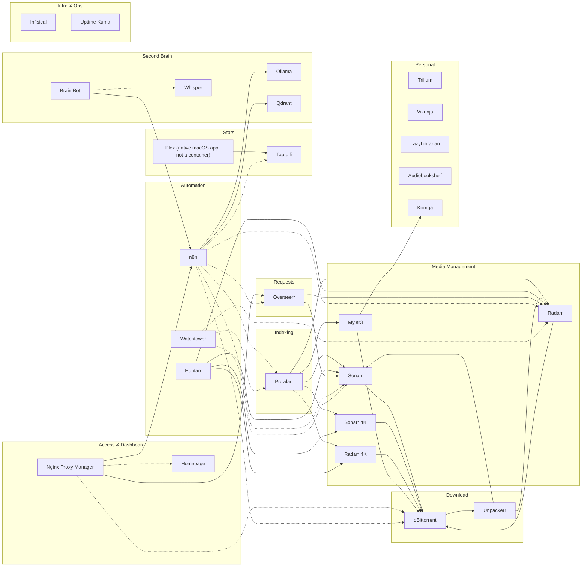

# Homelab Architecture Overview

Everything runs as Docker Compose services on a single Mac Mini (`192.168.178.69`) via OrbStack, one service directory per app at the repo root, each with its own `compose.yml`. Media libraries and downloads live on a UniFi UNAS Pro (`192.168.178.38`, UniFi OS), mounted natively by Docker's `local` CIFS volume driver directly inside OrbStack's VM — as of 2026-08-29 this replaced the old macOS-host SMB passthrough entirely (see `known-issues.md`). Its admin console is linked from Homepage under *Network & Storage*.

## Service Map

Infisical and Uptime Kuma are shown with no edges yet — both are deployed but not wired into anything else's dependency chain: Infisical is read from ad hoc by scripts (not yet by n8n directly), and Uptime Kuma has no monitors configured yet. Edges will get added here once that's real, not before.

Solid arrows are functional dependencies (data/API calls the app needs to work). Dotted arrows are n8n/Watchtower/NPM reaching in from outside — monitoring, automation, or routing rather than core function.

## Port Map

| Service | Host Port | Container Port | Notes |
|---|---|---|---|
| NPM (HTTP) | 80 | 80 | |
| NPM (HTTPS) | 443 | 443 | |
| NPM (Admin) | 81 | 81 | |
| Prowlarr | 9696 | 9696 | |
| n8n | 5678 | 5678 | |
| Trilium | 8080 | 8080 | |
| Homepage | 3000 | 3000 | |
| Overseerr | 30023 | 5055 | |
| qBittorrent WebUI | 30024 | — | `network_mode: host`, no port mapping |
| qBittorrent torrenting | 50415 | — | `network_mode: host` |
| Radarr | 30025 | 7878 | |
| Sonarr | 30027 | 8989 | |
| Sonarr 4K | 30030 | 8989 | |
| Radarr 4K | 30031 | 7878 | |
| LazyLibrarian | 30032 | 5299 | fixed 2026-08-17, was misconfigured as 30032:30032 |
| Audiobookshelf | 30033 | 30033 | |
| Vikunja | 30037 | 3456 | |
| Tautulli | 30035 | 8181 | |
| Huntarr | 30036 | 9705 | |
| Ollama | 11434 | 11434 | LAN only, no auth — do not expose publicly |
| Qdrant | 6333 | 6333 | LAN only, no auth — do not expose publicly |
| Infisical | 30034 | 8080 | LAN only, real auth (unlike Ollama/Qdrant) but holds secrets — conservative default |
| Uptime Kuma | 30038 | 3001 | LAN only for now |
| Authelia | 30039 | 9091 | SSO/OIDC provider — **requires `auth.kodyparton.com` via NPM to function**, see `sso.md` |
| Vaultwarden | 30040 | 80 | Password manager. SSO + local login both enabled (deliberate) |
| Paperless-ngx | 30041 | 8000 | Documents/OCR. SQLite + internal redis |
| AdGuard Home | 30043 (UI), 53 (DNS) | 80, 53 | LAN DNS resolver + ad blocking. Works around ISP DNS rebinding filter |
| Immich | 30042 | 2283 | Photos. Library on NAS (`/Volumes/media/immich`), not boot disk |
| Komga | 30045 | 25600 | Comics server + web reader + OPDS. `network_mode: bridge` (Docker subnet pools exhausted) |
| Mylar3 | 30046 | 8090 | Comics automation (the Sonarr of comics). `network_mode: bridge`. No hostname until its login is set |

`brain-bot` has no listening port — outbound only (Discord Gateway + calls to n8n).

Convention: LAN-only services generally live in the `300xx` range. `30034` (formerly a gap) is now Infisical.

## Domain / Reverse Proxy Map

All via Nginx Proxy Manager (`nginx-app-1`), certs via Let's Encrypt DNS-01 through Cloudflare — a single wildcard cert (`*.kodyparton.com`) covers every subdomain, so new subdomains don't need a new cert issuance, just a new proxy host reusing the existing certificate.

| Domain | Forwards to | Status |
|---|---|---|
| `n8n.kodyparton.com` | `192.168.178.69:5678` | working |
| `request.kodyparton.com` (Overseerr) | `192.168.178.69:30023` | working |
| `downloads.kodyparton.com` (qBittorrent) | `192.168.178.69:30024` | working (corrected from a stale `10.10.0.130`, verified 2026-08-27) |
| `home.kodyparton.com` (Homepage) | `192.168.178.69:3000` | working **via AdGuard Home** — see below |
| `auth.kodyparton.com` (Authelia SSO) | `192.168.178.69:30039` | working |
| `infisical.kodyparton.com` | `192.168.178.69:30034` | working |
| `vault.kodyparton.com` (Vaultwarden) | `192.168.178.69:30040` | working |
| `sonarr.kodyparton.com` | `192.168.178.69:30027` | working |
| `sonarr4k.kodyparton.com` | `192.168.178.69:30030` | working |
| `radarr.kodyparton.com` | `192.168.178.69:30025` | working |
| `radarr4k.kodyparton.com` | `192.168.178.69:30031` | working |
| `prowlarr.kodyparton.com` | `192.168.178.69:9696` | working |
| `books.kodyparton.com` (LazyLibrarian) | `192.168.178.69:30032` | working |
| `audiobooks.kodyparton.com` (Audiobookshelf) | `192.168.178.69:30033` | working — fixing this surfaced a pre-existing bug: compose mapped host `30033` to container `30033`, but the app actually listens on container port `80` and had never been reachable on `30033` at all. Fixed 2026-08-29 (`30033:80`), unrelated to DNS itself. |
| `tautulli.kodyparton.com` | `192.168.178.69:30035` | working |
| `paperless.kodyparton.com` | `192.168.178.69:30041` | working |
| `uptime.kodyparton.com` (Uptime Kuma) | `192.168.178.69:30038` | working |
| `tasks.kodyparton.com` (Vikunja) | `192.168.178.69:30037` | working |
| `notes.kodyparton.com` (Trilium) | `192.168.178.69:8080` | working |
| `huntarr.kodyparton.com` | `192.168.178.69:30036` | working |
| `dns.kodyparton.com` (AdGuard Home) | `192.168.178.69:30043` | working |
| `photos.kodyparton.com` (Immich) | `192.168.178.69:30042` | working |
| `comics.kodyparton.com` (Komga) | `192.168.178.69:30045` | working, **public via a Cloudflare-proxied record** (2026-10-11, same pattern as `request`/`n8n`); proxy host 25, created for YACReader and repointed to Komga the same day |
| `nas.kodyparton.com` (UniFi UNAS Pro admin) | **`https://192.168.178.38:443`** | added 2026-08-30 — upstream is **not** the Mac Mini, proxied over **https** |
| `ziggo.kodyparton.com` (Ziggo modem admin) | **`https://192.168.178.1:443`** | added 2026-08-30 — the WAN edge; same appliance pattern as `nas` |

The 17 rows above (`infisical` through `photos`) were added 2026-08-29 — Kody was hitting everything by raw IP:port, which broke password-manager autofill matching. Created via NPM's own REST API (proxy host IDs 6–22, reusing the existing wildcard cert, `certificate_id: 1` — no new cert issuance needed) plus a matching AdGuard Home local-DNS rewrite for each, same pattern as the rows above. All 22 domains verified with a real HTTPS request each. Skipped: Ollama/Qdrant/Whisper (API-only, no login UI worth naming) and purely-internal containers (databases, redis, socket-proxy).

`nas.kodyparton.com` and `ziggo.kodyparton.com` (both added 2026-08-30) are the exceptions to the shape of every other row: their upstreams are **network appliances** — the UNAS Pro (`192.168.178.38`) and the Ziggo cable modem (`192.168.178.1`) — not containers on the Mac Mini, and they are the **only https upstreams** in this NPM instance — the UNAS only speaks TLS and redirects `:80` to `:443`; the modem answers on both but is proxied over https by choice. Both present self-signed certificates (`CN=unifi.local` and `CN=OFW-UI-RootCA` respectively), so both proxy hosts carry `proxy_ssl_verify off` in their advanced config. The Ziggo modem also serves plain http, but https upstream was chosen anyway so modem admin credentials are not carried in the clear across the LAN hop. Client-facing TLS is unaffected: that is still the real wildcard cert, so the browser sees a valid certificate. Created by `scripts/add_device_proxy_hosts.py`.

**Important, learned the hard way (2026-08-27):** the internal-only hosts cannot rely on public DNS alone. A Cloudflare "DNS only" record pointing at `192.168.178.69` is correct, but the ISP/router path **silently drops DNS responses containing private IPs** (rebinding protection), so those names never resolved on the LAN. The fix is AdGuard Home (`adguard/`), which answers them locally — its response never crosses the filtering boundary. Clients must use `192.168.178.69` as their DNS server for this to take effect. Full diagnosis in `known-issues.md`.

## Data Flow (typical request lifecycle)

1. Request comes in via Overseerr (public, `request.kodyparton.com`) or is added directly in Sonarr/Radarr.
2. Sonarr/Radarr search via Prowlarr's aggregated indexers.
3. Grab sent to qBittorrent, which downloads to the NAS `downloads` share — mounted natively via CIFS (`nas_downloads` Docker volume) as of 2026-08-29, not the old macOS-host-passthrough bind mount.
4. Unpackerr extracts any archive qBittorrent can't hand off directly.
5. Sonarr/Radarr import the finished file into the library (also native CIFS volumes now — `nas_movies`/`nas_tv`/etc.).
6. Huntarr periodically re-triggers missing/upgrade searches in the background.
7. Plex (external) picks up new library files; Tautulli records what gets watched.

## Host Notes

- Container runtime is **OrbStack**, not Docker Desktop.
- **Plex is the one exception to "everything is a container"** — it runs as the native macOS app, and is therefore also the last remaining consumer of the old macOS-host smbfs mount (`/Volumes/media`). Both facts are deliberate: containerizing it would lose VideoToolbox hardware transcoding, since OrbStack's Linux VM on Apple Silicon has no GPU passthrough. See `docs/containers/plex.md`.
- Media/download storage is a UniFi UNAS Pro, mounted as native Linux CIFS volumes (`nas_*`) by Docker itself, with no macOS passthrough hop. This replaced the old host-passthrough bind mounts on 2026-08-29 and eliminated the mount-drop failure modes that workflow 09 was built to self-heal. It introduced a *different* one: a CIFS mount failure happens at container **creation**, so `restart: always` is never consulted and affected containers stay dead until something restarts them — see `known-issues.md` and `scripts/cifs_volume_health_check.sh`.
- OrbStack's VM memory is capped at **12GB** out of this Mac's 16GB total (`orb config set memory_mib 12288`) — raised from the 8GB default after real OOM-kills in the `ollama` container (see `docs/containers/ollama.md`). Changing this restarts every container on the host (`orb stop && orb start`); all come back automatically via `restart:unless-stopped`.
